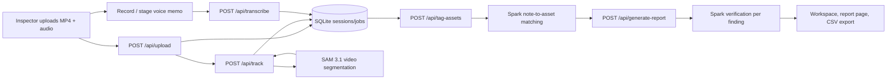

# GridSight

Drone footage of a substation goes in; a severity-ranked defect list comes out — every finding tagged **VISUAL** (cited frame) or **VOICE ONLY** (inspector's words, unverified), exportable as CSV.

[](LICENSE)


## Overview

One substation pass produces thousands of frames. No inspector watches all of it at 1× and catches everything. GridSight is for the substation inspector who flies the yard, dictates notes on the drive back, and needs a ranked defect list before the next shift.

**Before:** 45 minutes of 60fps drone video = 162,000 frames to review, plus an estimated ~3 hours of manual video scrubbing and spreadsheet logging back at the office. **After:** a roughly 15-minute automated pass during the drive back → verified, frame-cited CSV defect list ready before the truck parks. *(Frame count is exact arithmetic; the time figures are planning estimates, not measured results.)*

Upload a clip → track every asset with SAM 3.1 video segmentation → transcribe voice notes → pin each note to the asset visible at that moment → generate a report where Spark writes the defects and the server rebuilds the envelope. A second verification pass re-checks every visual finding against a fresh extraction of the exact frame it cited, and the model must answer one question: does this frame concretely show the claimed damage?

No key? `USE_CACHED=true` serves frozen fixtures for the full loop with zero API burn — an offline fallback, not live data. The cached demo showcases both paths: one **VISUAL** verified finding (frame citation + tracked SAM bbox + `keep` verdict) and one **VOICE ONLY** downgraded finding.

## Try it in 60 seconds

No API key, no network calls, no quota:

```bash
npm install
USE_CACHED=true npm run dev   # http://localhost:3000
```

Open the app, upload any MP4, and run the full loop: Upload → Track → Transcribe → Tag assets → Generate Report. With cached fixtures the pipeline returns the frozen demo session. For live inference, set `MODEL_API_KEY` in `.env.local` instead.

## Features

- **Track every asset in one pass** — SAM 3.1 multiplex segmentation with native-frame timestamps; per-prompt results persist incrementally so a late failure never wipes earlier prompts (`src/lib/track-run.ts`).
- **Dictate instead of typing** — in-browser recording or audio upload, diarized into timestamped transcript segments.
- **Notes pinned to assets, not timestamps** — each voice note links to the tracked object visible when it was spoken.
- **Reports that cite evidence** — every defect carries a frame citation and a verification verdict (`keep` / `downgrade` / `drop` / `skipped`); the server rebuilds inspection statistics itself instead of trusting model JSON.
- **Zero-hallucination default** — with no voice notes and no transcript, the model is instructed to return zero defects rather than invent damage.
- **Honest benchmarks** — a real-image static benchmark that reports NOT EVALUATED instead of a fake score when no predictions are supplied, plus a committed cached run that scores (see [Evaluation](#evaluation)).

## Key innovations

- **Verification pass with teeth** (`src/lib/verify.ts`, tests in `src/lib/__tests__/verify.test.ts`): visual findings are re-extracted at 1024px from the cited frame and re-judged. `drop` removes the finding, `downgrade` strips visual claims to VOICE ONLY, and a failed infrastructure call marks `skipped` — kept, never deleted, because deleting findings on infra failure is the worst failure mode in a safety product.
- **Server-built report envelope** (`src/app/api/generate-report/route.ts`): the model sometimes returns just `{summary, defects}` and drops the envelope, so the API validates only the defects and recomputes inspection/statistics itself.
- **Native-rate timestamps** (`src/lib/ffmpeg.ts`): upload probes real fps via `ffprobe`; SAM frame indices convert with it. A hardcoded 30 fps silently doubles every timestamp on 60 fps footage — this bit us once.
- **Resumable tracking runs** (`src/lib/track-run.ts`, `src/app/api/track/route.ts`): per-prompt persistence, prompt-boundary cancel checks, a server-side time budget, and closed-stream disconnects reported as disconnects with partial counts — not as model errors, never as silent empty results.
- **Auditable evaluation** (`scripts/bench.ts`, `fixtures/benchmark/real-v1/`): run manifests bind predictions to the execution that produced them (digests, dataset version, input checksums, per-frame provider-request evidence). The static-image benchmark separates detection (frame + category + visual evidence) from localization, and marks defect localization unavailable where ground-truth strips and model damage boxes annotate different targets — instead of laundering one into the other.

## Meta platform usage

All calls go through the Meta API (`https://api.meta.ai/v1`, OpenAI-compatible client); model IDs live in `src/lib/models.ts`.

| Role | Model | Used in |
|---|---|---|
| Eyes | `sam-3.1` | `src/lib/sam.ts` — text-prompted video segmentation, SSE record parsing (`<Nf>…<\|box…\|>` grammar) |
| Ears | `muse-voice-transcribe-1.0` | `src/app/api/transcribe/route.ts` — diarized drive-back memos |
| Analyst | `muse-spark-1.3` (or Muse Spark Open via `SPARK_PROVIDER`) | `src/lib/tagging.ts`, `src/app/api/generate-report/route.ts` — note-to-asset matching, defect drafting, verification verdicts |

Tracking (SAM), Files, and transcription always stay on Meta; only tagging/report/verification can move to Baseten or Modal. The active provider is stamped on every report (`modelRun`).

## Architecture



Upload probes duration/fps and stashes the clip; tracking streams per-prompt progress over SSE into cancellable jobs; transcription and tagging attach to the same session; the report endpoint validates model defects, rebuilds the envelope, and persists the artifact the report page renders.

## Evaluation

Three harnesses, all runnable without a key or network. Numbers below were reproduced from this repo (vitest 282 passed / 22 files; `eval:smoke` 11 checks passed).

**Frame eval** — cached model outputs re-scored against 30 labeled frames (20 clean, 10 defective), zero quota:

```bash
npx tsx scripts/eval.ts          # cached re-scoring, no inference
npx tsx scripts/eval.ts --live   # re-records responses (burns quota, needs the clip)
```

```
GridSight eval — 30 frames (20 clean, 10 defective) — model muse-spark-1.3
first pass P=1.00 R=1.00 FP=0 FN=0 · verified P=1.00 R=1.00 FP=0 FN=0
```

Read honestly: the 10 defective frames are adjacent seconds of the *same* rusted pole, not ten independent defects. This measures hallucination rate and single-defect recall — a smoke test, not a benchmark. `fixtures/eval/cache/` holds the recorded per-frame responses; ground truth in `fixtures/eval/labels.json` was set by viewing frames before any model run.

**Real-image benchmark** — 13 annotated cases over 12 derivative stills (3 scenes, 6 assets, 1 rust-pole defect episode across 5 frames), with checksummed provenance in `fixtures/benchmark/real-v1/`:

```bash
npm run bench        # synthetic pipeline-logic cases: 8 passed, 0 failed
npm run bench:real   # real-v1: exits 2, every case NOT EVALUATED — no artifact supplied
npm run bench:real:scored  # real-v1 + committed cached predictions: PASS, P=1.00 R=1.00
```

The scored run uses `fixtures/benchmark/real-v1/predictions-cached-v1.json` — 12 recorded `muse-spark-1.3` outputs (`provenance: cached`, 5 visual rust keeps on f021/f023/f025/f028/f030, 7 clean no-findings) scored with the static frame-linked matcher. Detection matches on frame + category + visual evidence only; boxes never gate detection on this path. `provenance: actual` would require a run manifest with per-frame provider-request evidence (see `PREDICTIONS.md`) — this artifact honestly stays `cached`, never `actual`.

No predictions ship with the dataset by default, so visual accuracy reports UNAVAILABLE until matching pipeline predictions are recorded (`--predictions=<artifact.json>`). Exit codes are contractual: 0 pass · 1 fail · 2 not-evaluated · 3 input error. An incomplete or manifest-less run exits 2 — never a silent pass, never a fabricated zero.

## What is real vs. simulated

| Component | Status | Evidence |
|---|---|---|
| Upload, track, transcribe, tag, report, CSV export | Working | `src/app/api/*`, exercised live and in tests |
| SAM tracking on full-resolution footage | Working | 594-frame tower track in a recorded session |
| Cached demo mode (`USE_CACHED=true`) | Frozen sample | `src/lib/demo-fixture.ts` — frozen fixtures, zero burn; showcases one VISUAL verified finding + one VOICE ONLY downgraded finding |
| Benchmark detection scores | Measured on recorded outputs | `bench:real:scored` reports P=1.00 R=1.00 on the rust episode (12-frame cached run); `bench:real` without predictions stays NOT EVALUATED |
| Synthetic benchmark (`bench`) | Working, limited | 8 pipeline-logic cases — evidence handling only, no images |
| PDF export | Planned | CSV ships; PDF deferred |

## Quick start

Prerequisites: **Node 22.5+** (uses `node:sqlite`), `ffmpeg` + `ffprobe` on `PATH` (duration/fps probing, thumbnails, key frames).

```bash
npm install
cp .env.example .env.local   # then set MODEL_API_KEY
npm run dev                  # http://localhost:3000
```

| Command | What it does |
|---|---|
| `npm run dev` | Dev server (`--port 3101` to pin a different port) |
| `npm test` | Vitest suite — 282 tests, 22 files |
| `npx tsc --noEmit` | Typecheck |
| `npm run lint` | Next.js ESLint |
| `npm run build` | Production build (10 API routes + 4 pages) |
| `npm run eval:smoke` | Quota-free pipeline smoke test (11 checks) |

Helper scripts (each burns quota unless noted):

```bash
npx tsx scripts/smoke-meta.ts   # one-shot API smoke test — run sparingly
npx tsx scripts/smoke-models.ts # per-model PASS/FAIL probe — never in CI
npx tsx scripts/cache-demo.ts   # freeze a live session into fixtures for offline demo
```

`fixtures/demo-session/report.json` is a representative sample, not a captured run. To capture a real SAM response for the parser test: `npx tsx scripts/capture-sam-sample.ts <file_id> "<prompt>"` (one call, never in CI).

## Configuration

All in `.env.local` (never committed):

| Variable | Required | Default | Purpose |
|---|---|---|---|
| `MODEL_API_KEY` | Yes (live) | — | Meta API key (vision + language) |
| `SPARK_PROVIDER` | No | `meta` | Spark endpoint: `meta`, `baseten`, `modal` — env only, no UI picker |
| `SPARK_MODEL` | No | `muse-spark-1.3` | Model override for `meta` |
| `BASETEN_BASE_URL` / `BASETEN_MODEL` / `BASETEN_API_KEY` | For `baseten` | inference.baseten.co, `meta-models/muse-spark-open-1026` | Muse Spark Open via Baseten |
| `MODAL_BASE_URL` / `MODAL_MODEL` / `MODAL_API_KEY` | For `modal` | — | Muse Spark Open self-served (all three required) |
| `NEXT_PUBLIC_APP_URL` | No | `http://localhost:3000` | Public URL |
| `USE_CACHED` | No | `false` | `"true"` serves frozen fixtures, zero API burn (offline demo) |
| `GRIDSIGHT_TMP_DIR` | No | `/tmp/opencode/gridsight` | Scratch dir (video, frames, audio, reports) |
| `GRIDSIGHT_DB_PATH` | No | `<scratch>/gridsight.db` | SQLite path override |

Missing keys fail loudly at request time, never by silent fallback. Tracking (SAM), Files, and transcription always stay on Meta.

## Tech stack

- **App:** Next.js 14 App Router, React 18, Tailwind CSS. No database server — SQLite via `node:sqlite` (WAL mode) plus a local scratch dir.
- **AI:** `openai` SDK pointed at Meta; all model IDs in `src/lib/models.ts`. Muse Image retired from the report path (deterministic bbox overlays instead).
- **Validation:** Zod schemas on every API boundary; envelope-tolerant report parsing.
- **Tests:** Vitest, co-located in `src/lib/__tests__/`.

## Project structure

```
src/
  app/
    page.tsx                 landing + upload
    dashboard/               all inspections
    inspection/[id]/         workspace (tracking, transcript, report)
    inspection/[id]/report/  final report + CSV export
    api/
      upload/ track/ transcribe/ tag-assets/
      generate-report/ frames/ sessions/ jobs/ health/
  lib/
    sam.ts track-run.ts  SAM request shape, SSE parser, resumable prompt loop
    meta-client.ts models.ts  OpenAI SDK client, single source of model IDs
    store.ts db.ts        SQLite persistence
    jobs.ts               cancellable job engine + SSE progress
    frames.ts ffmpeg.ts   thumbnails, key frames, probing
    tagging.ts            voice-note → asset matching
    report.ts verify.ts   prompts, evidence labeling, validation, audit pass
    export.ts images.ts net.ts audio.ts client-video.ts
    demo-fixture.ts       frozen offline data (USE_CACHED=true)
  components/  UploadZone, TrackingViewport, VideoOverlayPlayer,
               TranscriptPanel, AssetList, Timeline, DefectCard,
               SeverityChart, PipelineProgress
fixtures/      eval/ (labels + recorded responses), benchmark/ (v1 synthetic, real-v1 static-image)
scripts/       eval.ts, bench.ts, eval-smoke.ts, eval-to-predictions.ts, smoke-*.ts, cache-demo.ts
```

## API sketch

| Route | Method | Notes |
|---|---|---|
| `/api/upload` | POST | multipart video (+ optional audio); probes duration/fps |
| `/api/track` | POST | SSE stream; `{sessionId, prompts[]}`; cancellable, per-prompt persistence |
| `/api/transcribe` | POST | multipart audio or `{sessionId}` |
| `/api/tag-assets` | POST | `{sessionId}` → notes with `matchedAssetId` |
| `/api/generate-report` | POST/GET | SSE stream / fetch saved report |
| `/api/frames/[sessionId]/[name]` | GET | JPEG thumbnails + key frames |
| `/api/sessions[?sessionId=]` | GET | list or single session meta |
| `/api/jobs` | POST | `{action: "cancel", jobId}` |

## Deploy (Docker)

Serverless can't run this app (`ffmpeg`/`ffprobe` for probing and key frames, writable SQLite, local scratch dir), so it ships as a container:

```bash
docker build -t gridsight .
docker run -p 3000:3000 -e MODEL_API_KEY="$MODEL_API_KEY" gridsight
```

`GET /api/health` returns `{ ok, ffmpeg, dbWritable, version }` with no auth and no secrets (also the container HEALTHCHECK).

## Known limits

- Single-user, single-node: SQLite + local scratch dir, no auth.
- The cached demo (`USE_CACHED=true`) is a frozen two-finding sample: one `VISUAL` verified finding (frame citation + tracked bbox + `keep`) and one `VOICE ONLY` downgraded finding. The `VISUAL` path on live footage needs a real run — freeze it with `scripts/cache-demo.ts` before recording.
- Key frames are downscaled to 1280px (q≈4, ~40–150KB) before they are sent to Spark; full-resolution frames would blow the vision request budget.
- Transcription needs staged audio (record in-browser or attach a file); visual findings still work without it, but note-only findings require a transcript.
- Thumbnail/key-frame extraction needs `ffmpeg`; failures skip loudly per-asset without failing the batch.
- Scene-level tracking prompts (e.g. "electrical substation") return whole-frame boxes — use object-level prompts ("insulator", "transformer tank") for usable tracks.
- PDF export is deferred; CSV export ships (with `evidenceSource` + `observation` columns).

## License

MIT — see [LICENSE](LICENSE).
